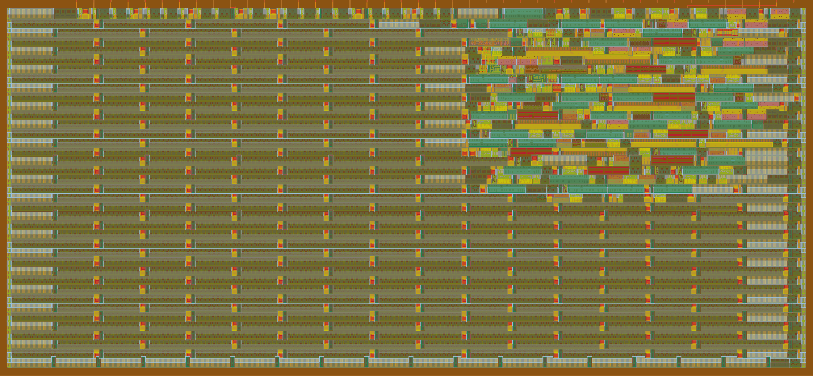
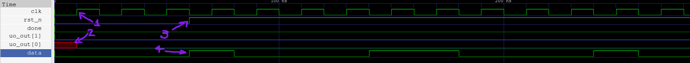
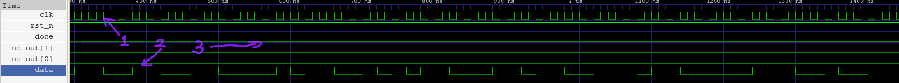
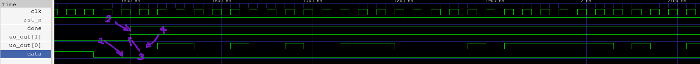

# CRC32



A reflected CRC32 implementation in verilog. \
This is a relatively simple project, with only 2 inputs (not including clock and reset) and 2 outputs (one of wich being an echo of one of the inputs).

## The CRC32 algorithm

### What is CRC32?

CRC stands for cyclic redundancy check, and the 32 means it outputs a 32 bit checksum. \
It is used in things like ZIP, Ethernet and PNG.

### The algorithm

The CRC algorithm divides the input by a binary number derived from a polynomial. \
More specifically the coeficients of the polynomial, so for an example CRC4 algorithm, lets take the arbitrary polynomial `x⁴+x³+x`, \
we have the coeficients `1x⁴+1x³+0x²+1x¹+0x⁰`, giving us the number `11010`. \

Now to calculate our checksum of an arbitrary input, say `1011100`, we:
```
1011100 0000   <-- we pad the input with the polynomial grade number of zeroes
11010          <-- xor by the polynomial number
------------
01101000000
```
next shift over to the next `1` in the result
```
0110100 0000
 11010
-----------   <-- repeat
0000000 0000
```
In this case we got all zeroes, which means the checksum is `0`.

## The very basics of verilog

### Wires

A `wire` is what is called a net, it describes a physical connection. \
It can not store anything, and must be continuosly assigned to something using an `assign` statement.

### Reg

A `reg` is a variable, can hold a value, and is assigned inside an `always` or `initial` block.

## Short overview of source code

```
`default_nettype none // Disables implicit nets
 

module tt_um_crc32 ( // declares the module
	input  wire [7:0] ui_in,    // Dedicated inputs
	output wire [7:0] uo_out,   // Dedicated outputs
	input  wire [7:0] uio_in,   // IOs: Input path
	output wire [7:0] uio_out,  // IOs: Output path
	output wire [7:0] uio_oe,   // IOs: Enable path (active high: 0=input, 1=output)
	input  wire       ena,      // always 1 when the design is powered, so you can ignore it
	input  wire       clk,      // clock
	input  wire       rst_n     // reset_n - low to reset
);

	reg [31:0] crc;
	reg [31:0] next_crc;   // declarations of reg:s and net:s
	wire done;
	assign done = ui_in[1];// continuos assignment of wire, done is always equal to whatever ui_in[1] is at that time
	wire fb;                           // Declaring the feedback bit
	assign fb = crc[31] ^ ui_in[0];    // Continuosly assigning the feedback bit as the first bit in the register xor:ed against the input.
	always @(*) begin
		next_crc = crc;
		if (!done) begin
		next_crc = crc << 1;              // shifting over one bit
		next_crc[26] = fb ^ next_crc[26]; // actually doing the CRC32
		next_crc[23] = fb ^ next_crc[23];
		next_crc[22] = fb ^ next_crc[22];
		next_crc[16] = fb ^ next_crc[16];
		next_crc[12] = fb ^ next_crc[12];
		next_crc[11] = fb ^ next_crc[11];
		next_crc[10] = fb ^ next_crc[10];
		next_crc[8 ] = fb ^ next_crc[8 ];
		next_crc[7 ] = fb ^ next_crc[7 ];
		next_crc[5 ] = fb ^ next_crc[5 ];
		next_crc[4 ] = fb ^ next_crc[4 ];
		next_crc[2 ] = fb ^ next_crc[2 ];
		next_crc[1 ] = fb ^ next_crc[1 ];
		next_crc[0 ] = fb ^ next_crc[0 ];
		end

	end
	always @(posedge clk) begin
		if (!rst_n)  begin 
			crc <= 32'hFFFFFFFF;   // init at reset
		end
		else if (!done) crc <= next_crc;
	end
	wire [31:0] rev;
	genvar i;
	generate 
		for (i = 0; i < 32; i = i + 1) begin     // Reversing the register at output
			assign rev[i] = crc[31-i];
		end
	endgenerate
	wire [31:0] out;
	assign out = ~rev;              // inverting the reversed register at output


	reg sout;
	reg [4:0] count2;
	reg shifting;
	always @(posedge clk) begin
		if (!rst_n) begin
			sout <= 0;
			count2 <= 0;      // initing at reset
			shifting <= 1;
		end
		else if (done && shifting) begin
			sout <= out[count2];        // shifting the register out, one bit per clock on output
		if (count2 == 31) shifting <= 0;
		else count2 <= count2 + 1;      // counting the bits for output
		end
	end

	assign uio_oe = 0;	
	assign uio_out = 0;             // assigning unused IO:s
	assign uo_out[7:2] = 0;
	wire _unused = &{ena, ui_in[7:2], uio_in, 1'b0};
	assign uo_out[0] = sout;
	assign uo_out[1] = done;    // assigning outputs


endmodule
```

I'll now go through the code one `always` block at a time

### Always block one

```
always @(*) begin
    next_crc = crc;
    if (!done) begin
    next_crc = crc << 1;
    next_crc[26] = fb ^ next_crc[26];
    next_crc[23] = fb ^ next_crc[23];
    next_crc[22] = fb ^ next_crc[22];
    next_crc[16] = fb ^ next_crc[16];
    next_crc[12] = fb ^ next_crc[12];
    next_crc[11] = fb ^ next_crc[11];
    next_crc[10] = fb ^ next_crc[10];
    next_crc[8 ] = fb ^ next_crc[8 ];
    next_crc[7 ] = fb ^ next_crc[7 ];
    next_crc[5 ] = fb ^ next_crc[5 ];
    next_crc[4 ] = fb ^ next_crc[4 ];
    next_crc[2 ] = fb ^ next_crc[2 ];
    next_crc[1 ] = fb ^ next_crc[1 ];
    next_crc[0 ] = fb ^ next_crc[0 ];
    end
end
```

The `always @(*)` means that the code inside the block runs anytime anything on the right hand side of an assignment inside the block is updated. \
For example, this is the first line of the block:
```
Left hand side
   ↓
next_crc = crc;
            ↑
     Right hand side
```
So anytime the right hand side (crc) is updated, all of the code in the block is run.

This
```
if (!done) begin
```
means that the code inside the if statement (until the next `end`) will run if `done` is `0`. \
This is because when all the input has been fed, and done goes high, we want to output the register without updating it further.

This line
```
next_crc = crc << 1;
```
shifts the register one bit to the left.

These next couple of lines
```
next_crc[26] = fb ^ next_crc[26];
next_crc[23] = fb ^ next_crc[23];
next_crc[22] = fb ^ next_crc[22];
next_crc[16] = fb ^ next_crc[16];
next_crc[12] = fb ^ next_crc[12];
next_crc[11] = fb ^ next_crc[11];
next_crc[10] = fb ^ next_crc[10];
next_crc[8 ] = fb ^ next_crc[8 ];
next_crc[7 ] = fb ^ next_crc[7 ];
next_crc[5 ] = fb ^ next_crc[5 ];
next_crc[4 ] = fb ^ next_crc[4 ];
next_crc[2 ] = fb ^ next_crc[2 ];
next_crc[1 ] = fb ^ next_crc[1 ];
next_crc[0 ] = fb ^ next_crc[0 ];
```
Implements the xor taps with the feedback bit according to the polynomial `x³²+x²⁶+x²³+x²²+x¹⁶+x¹²+x¹¹+x¹⁰+x⁸+x⁷+x⁵+x⁴+x²+x¹+x⁰`. Now notice how the polynomial has an `x³²` term, but the code dosent. This is because that term is already shifted out of the register. Doing these taps is mathematically equivalent to the binary division done in the example.

### Always block 2

```
always @(posedge clk) begin
	if (!rst_n)  begin 
		crc <= 32'hFFFFFFFF;
	end
	else if (!done) crc <= next_crc;	
end
```

This
```
always @(posedge clk) begin
```
again means that the code inside the block runs anytime `clk` is on the positive edge, so it updates when `clk` goes from `0` to `1`, but not `1` to `0`.


This,
```
if (!rst_n)  begin 
	crc <= 32'hFFFFFFFF;
end
```
scince reset is active low, means that when reset is active, it initializes crc to the hex value `0xFFFFFFFF`. \
This is so that the register starts as a clean slate whenever a new checksum is to be calculated, and not with whatever leftover there is from the previous calculation. The reason it's initiated to all ones and not zeroes is because if the register is all zeroes, an input with any amount of zeroes prepended will give the same checksum. So for example, `11010` would give the same checksum as `000011010`.

As we saw in the previous `always` block, we set `next_crc = crc;` and update what the *next* register value should be, \
and in this block `crc` is set to `next_crc`'s value:
```
else if (!done) crc <= next_crc;
```

### Generate block

```
generate
	for (i = 0; i < 32; i = i + 1) begin
		assign rev[i] = crc[31-i];
	end
endgenerate
```

This is a generate for loop. It differs from the always block in the way that, instead of behavioral repetition like in an always block, repetition only uses a wire, no logic required.

All it does is reverse `crc` and put it in `rev`.

### Third always block

```
always @(posedge clk) begin
	if (!rst_n) begin
		sout <= 0;
		count2 <= 0;
		shifting <= 1;
	end
	else if (done && shifting) begin
		sout <= out[count2];
	if (count2 == 31) shifting <= 0;
	else count2 <= count2 + 1;
	end
end
```

The first
```
if (!rst_n)
```
just initializes on reset, nothing too fancy, but the rest is what counter selects the register one bit at a time into `sout` for output.

The `shifting` variable tells us if we are still outputing the reg, or if everything has been output already. That's why its counting, to know when its output out all 32 bits.
```
else if (done && shifting) begin   <-- checks if we are actively shifting output out
	sout <= out[count2];          <-- selects the current bit into sout
if (count2 == 31) shifting <= 0;   <-- Sees if all bits are output, if so set shifting to 0
else count2 <= count2 + 1;        <-- otherwise count up
end
```

### The rest

Here im going to talk about the small code snippets between the blocks left unexplained, from top to bottom.

```
reg [31:0] crc;
reg [31:0] next_crc;
wire done;
assign done = ui_in[1];
wire fb;
assign fb = crc[31] ^ ui_in[0];
```

This is from directly above the first always block. All lines beginning with either `reg` or `wire` are declaring either a `reg` or `wire` respectively.\
Take for example this line:
```
reg [31:0] crc;
```
is declaring `crc` as a 32-bit (bit 31 to 0) register of flip-flops. Compare that to `next_crc`, which is declared the exact same way, but dosent have flip-flops, and is instead just logic. The difference is in where the two are assigned. `next_crc` is assigned in an `always @(*)` block, while `crc` in an `always @(posedge clk)`. The difference being that `crc` is assigned in a clocked, non-blocking always block, while `next_crc` is assigned in a blocking combinational always block.

The difference between blocking (`=`) and non-blocking (`<=`) is that in always blocks with blocking assignments, the assignments are assigned in order from top to bottom, but in non-blocking assignments, everything is done at the same time, in paralell.

The first `assign` statement just sets `done` equal to `ui_in[1]`, which is the done input. \
The second `assign` statement assigns the feedback bit as the first register position xor:ed to the input, which is used for the xor taps.

This line
```
genvar i;
```
can be found before the generate block. A genvar is a special variable used in generate loops to control how instances are created during elaboration.

```
assign out = ~rev;
```
This line is located below the generate block, and it bit inverses the reversed register and assigns out to it. This is because the definition of CRC32 calls for this inversion, and the reversing is the "reflected" part of the reflected CRC32.

```
assign uio_oe = 0;
assign uio_out = 0;
assign uo_out[7:2] = 0;
wire _unused = &{ena, ui_in[7:2], uio_in, 1'b0};
assign uo_out[0] = sout;
assign uo_out[1] = done;
```
These lines ties unused outputs to zero, RHS assigns unused inputs so the verilog linter dosent complain, and assigns the final used outputpins to sout and done.

Any code left unexplained is trivial, and left as an exercise for the reader.

## Waveforms

Now, lets take a look at some of the computed waveforms



This is an image of the waveforms generated by the program plus a testbench, viewed in GTKwave. I have included some arrows with numbers to make it a bit easier.

Arrow number one is pointing at the `clk` signal. This is what decides the timing of the chip. \
Arrow number two is pointing at a red box from `uo_out[0]`. `uo_out[0]` is the output pin (`sout` in the code), and the red box means it is uninitialized. This is because `sout` isn't initialised until the first clock, and we can se that at the first clock, the red box turns into a `0`.

Arrow number three is pointint at the posedge of `rst_n`. Scince `rst_n` is active low, it going high means it turns inactive. As soon as reset goes inactive the program starts reading input on the next clock edge, and as we can see at arrow four, as soon as reset goes inactive, the testbench starts feeding data bits to the input.

Now for the next part of the waveform



This is about halfway through the simulation.

Arrow one is pointing at the clock. As you can see its still going, and always will be.
Arrow two is pointing at the data pin. It's continuing to feed data for the program to calculate the checksum with.
At arrow number three you can see that both the output pins and the `done` signal are low, this is because the TB dosent drive `done` high until ii's fed all the input bits, one of the outputs is an echo of done, and the second output is `sout` which holds its reset value until the program starts outputing.



Now this one is a little bit more interesting. This is the end of the simulation.

As you can see at arrow one, the TB feeds it's last input bit, a zero. \
After the last bit has been fed, at arrow two, the TB drives `done` high, indicating that all input bits have been fed. \
At the same time, at arrow three, the programs `uo_out[1]` goes high. This is because that output is simply an echo of the `done` input. \
Then, at arrow four, the program starts driving the output, the first bit being a zero.

## Pitfalls, snags, and perils

This section is about the trouble faced while developing this.

### Research

Finding out how the CRC32 algorithm works was the first hurdle, as any search along the lines of `CRC32 algorithm` only gave results on checksum calculators and the occasional uninformative wikipedia page.

### Getting the algorithm right

This is a combination of the previous header, and me being bad at verilog, but it took me a really long time to get the CRC algorithm to work in accordance with the standard. Most of the problems were with how the register was output, but the testbench was also an issue. The TB was waiting one clock signal after reset before outputing, meaning it was processing an extra zero at the beginning.
Another issue was that I in the beginning had the `done` signal internally driven. This both meant that the inputs had to be of fixed length, and due to the above error, it was both reading an extra zero at the beginning, and also not reading the last bit, making the output wrong.

### Getting the TB to work

Scince my program takes the input the input LSB first, and due to the way verilog stores strings, inputing correctly requires this weird modulo math that took me a while to figure out. `64 - 8*(n/8) + (n%8)` is the math, it looks like 8*(n/8) is just n, but scince n is an integer, verilog drops the remainder from the division. Due to this, 8*(n/8) gets the nearest multiple of eight thats smaller than or equal to n. This gets subtracted from 64, and then n (mod 8) gets added to that. Now scince the data i was trying to feed was "123456789" was 9 bytes, which is 72 bits (9*8), so to look at the last bit being fed for example, 64-8*(71/8)+(71%8). Scince 71 isn't divisible by eight, we have to worry about verilogs integer division, so 71/8 is about 8.9, drop the remainder to 8, multiply by 8, we get 64. 64-64 is 0, and 71 modulo 8 is 7, meaning the last bit fed is the bit at zero indexed position 7.

## Usage

To use it, first drop `rst_n` to 0 and hold for at least 1 clock cycle. Raise `rst_n` to 1 (not on a clock posedge) and start feeding your input LSB first. The input is red on the clk posedge from the very first posedge after `rst_n` is raised to 1, so I adwise you start feeding the bit on the negedge before that. When the entire message is fed, raise `done` high on the clock negedge directly after the clock posedge where the last input bit was red. Start reading the output LSB first from the first clock posedge after the done signal has been red, that would be the secont clock posedge after done was raised high.

### Testing

It can be tested by compiling the `test/tb_standalone.v` and `src/project.v` files, and simulating them with vvp. The simulation should display either `PASS` or `FAIL`, depending on the outcome of the test.

## Further reading

If you want to learn more about verilog you can check out [this](https://en.wikipedia.org/wiki/Verilog), and if you want to learn more about cyclic redundancy checks you can read [this](https://en.wikipedia.org/wiki/Cyclic_redundancy_check) and [this](https://en.wikipedia.org/wiki/Computation_of_cyclic_redundancy_checks).
